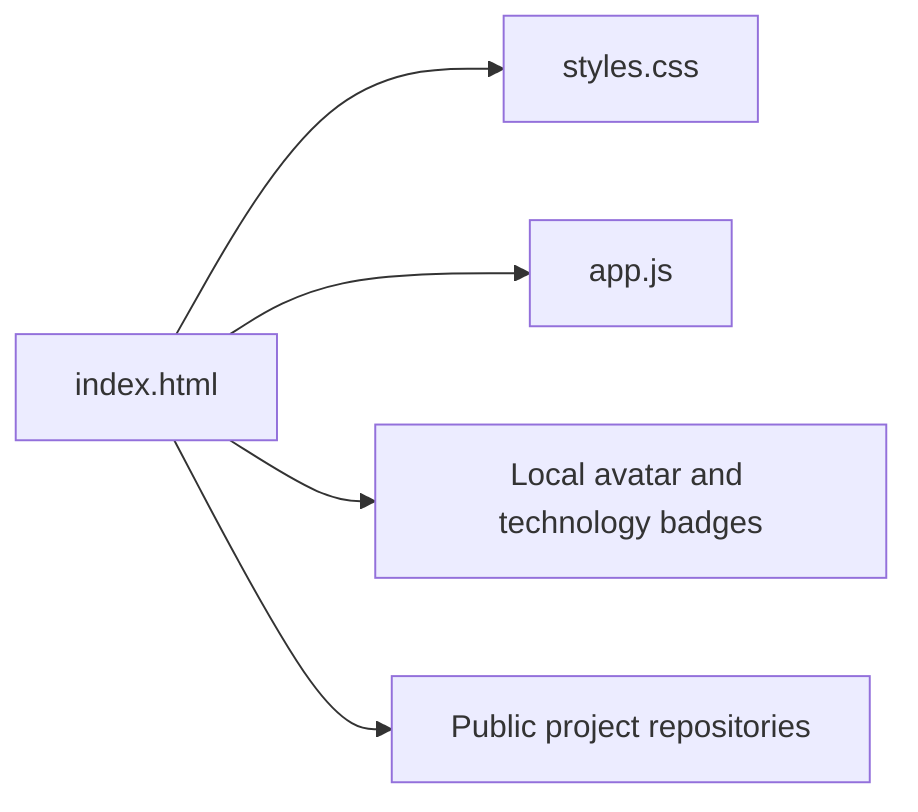

# Lexus · personal website

A lightweight portfolio for [dr-lexus-dr](https://github.com/dr-lexus-dr), inspired by a clean GitHub profile layout. Plain HTML, CSS, and JavaScript; no build step, package installation, tracking, or remote font dependencies.

## Preview

```sh
python3 -m http.server 8000 --directory site
```

When running from this repository's root after publication, use `python3 -m http.server 8000` instead.

## Structure



## Editing

Update the biography, project links, and simplified bOS diagram in `index.html`. Theme and responsive layouts live in `styles.css`. Technology badges and the GitHub avatar are local assets in `assets/`.

The existing `CNAME` is preserved so GitHub Pages continues to use `dr-lexus-dr.musorum.com`.
